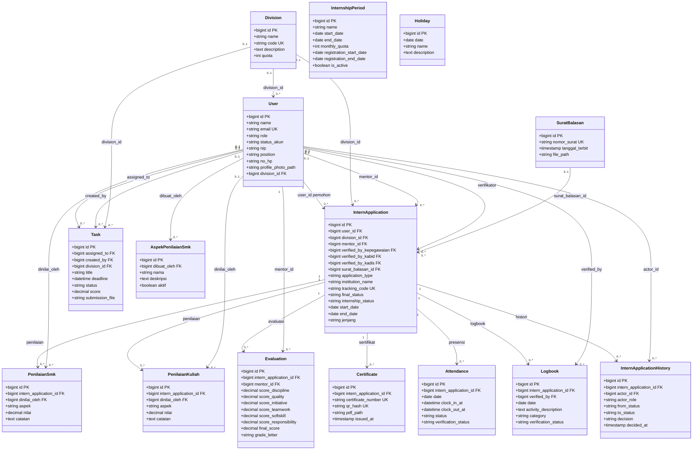

# Class Diagram Database SIMAGANG

Diagram kelas berikut merangkum tabel domain dari skema database setelah seluruh migrasi proyek diterapkan. Kolom yang ditampilkan adalah identitas, foreign key, dan atribut utama; kolom audit `created_at` dan `updated_at` tidak ditampilkan agar diagram tetap terbaca. Tabel infrastruktur Laravel tidak disertakan.

### Catatan

- Kardinalitas mengikuti foreign key dan batasan unik pada migrasi; misalnya `Evaluation` dan `Certificate` terhubung ke `InternApplication` sebagai satu-ke-banyak karena foreign key aplikasi belum diberi constraint unik.
- Referensi `User` ke `InternApplication` dengan label `verifikator` merangkum tiga foreign key terpisah: `verified_by_kepegawaian`, `verified_by_kabid`, dan `verified_by_kadis`.
- `InternshipPeriod` dan `Holiday` merupakan tabel domain tanpa foreign key ke tabel lain pada skema saat ini.
- Kolom atribut lengkap dan detail aturan tersedia di migrasi `database/migrations`.
