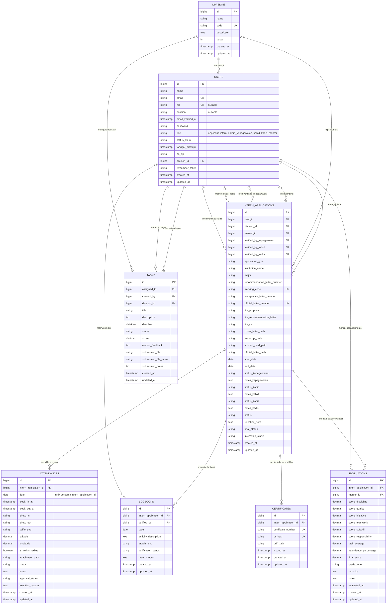

# ERD SIMAGANG

ERD ini merangkum skema domain SIMAGANG berdasarkan migrasi database proyek saat ini. Tabel infrastruktur Laravel seperti `migrations`, `sessions`, `cache`, `jobs`, dan `personal_access_tokens` tidak ditampilkan agar fokus pada proses bisnis magang.

## Metode Agile yang disarankan

ERD dikembangkan dan ditinjau secara bertahap bersama Product Owner/pengguna. Setiap iterasi menghasilkan bagian skema yang dapat divalidasi terhadap alur aplikasi, bukan menunggu seluruh sistem selesai.

| Iterasi | Product backlog / hasil | Kriteria penerimaan |
|---|---|---|
| Sprint 1 — Fondasi akun dan bidang | `USERS`, `DIVISIONS` | Peran pengguna, status akun, bidang, dan kuota sesuai proses registrasi dan pengelolaan bidang. |
| Sprint 2 — Pengajuan dan persetujuan | `INTERN_APPLICATIONS` serta relasi ke pengguna, bidang, mentor, dan verifikator | Alur pelacakan dan persetujuan Kepegawaian, Kabid, serta Kadis dapat ditelusuri dari relasi dan status yang tersimpan. |
| Sprint 3 — Aktivitas magang | `ATTENDANCES`, `LOGBOOKS`, `TASKS` | Peserta dapat mencatat presensi, mengisi logbook, dan menerima/mengumpulkan tugas; mentor dapat meninjau aktivitas. |
| Sprint 4 — Evaluasi dan keluaran | `EVALUATIONS`, `CERTIFICATES` | Evaluasi mengacu pada peserta dan mentor, serta sertifikat terhubung dengan peserta yang menerimanya. |
| Review dan iterasi | Tinjau diagram, istilah, kardinalitas, dan kebutuhan baru bersama pemangku kepentingan | Perubahan disepakati dan diagram diperbarui sebelum perubahan skema database diterapkan. |

### Catatan relasi

- Master `DIVISIONS` disediakan dinamis melalui API. Seeder saat ini memastikan empat kode: `ikp`, `statistik`, `aptika`, dan `tki`; Kabid/mentor ditautkan dengan `division_id`.
- `USERS.nip` bersifat unik dan nullable agar akun non-pegawai serta akun lama tetap kompatibel; `position` menyimpan jabatan pegawai dan nullable.
.drawio.- Verifikator persetujuan dan mentor disimpan sebagai relasi ke `users`.
- `ATTENDANCES` menyimpan waktu sebagai `clock_in_at`/`clock_out_at` dan memiliki batasan unik gabungan pada `intern_application_id` dan `date`.
- `EVALUATIONS` menggunakan kolom nilai `score_*`; kolom skor duplikat dengan nama lama telah dihapus. Foreign key mentor tetap mengacu ke `users`.
- Notasi `o|` menunjukkan relasi opsional karena foreign key terkait nullable; `||--o{` menunjukkan satu induk dapat memiliki banyak data turunan.
- Karena migration belum menambahkan batasan unik pada `evaluations.intern_application_id` dan `certificates.intern_application_id`, diagram fisik menggambarkan relasi satu-ke-banyak. Alur aplikasi dapat membatasi penggunaan menjadi satu evaluasi/sertifikat per penempatan.
- `internship_status` adalah kolom string dengan nilai awal `in_progress`; aplikasi dapat memperbaruinya, misalnya menjadi `completed`.
- Diagram ini menggambarkan struktur setelah migration refactoring aktivitas diterapkan.

## ERD Konseptual Proses Bisnis

Diagram berikut disematkan langsung di dokumen menggunakan bentuk Mermaid yang mendekati notasi Chen: kotak untuk entitas, oval biru untuk atribut, belah ketupat oranye untuk relasi, serta label `1`, `N`, dan `0..1` untuk kardinalitas. Atribut kunci diberi label `(PK)` dan `(FK)`. Sumber PlantUML versi Chen tersedia di [`erd_konseptual.puml`](./erd_konseptual.puml).

```mermaid
flowchart TB
    PEMOHON[PEMOHON]
    P_ID([id PK])
    P_EMAIL([Email])
    P_NAMA([Nama])
    P_PENDIDIKAN([Pendidikan])
    PEMOHON --- P_ID
    PEMOHON --- P_EMAIL
    PEMOHON --- P_NAMA
    PEMOHON --- P_PENDIDIKAN

    PERMOHONAN[PERMOHONAN]
    A_ID([id PK])
    A_USER_ID([user_id FK → users.id])
    A_TRACKING([Kode Tracking])
    A_INSTITUSI([Institusi])
    A_STATUS([Status])
    PERMOHONAN --- A_ID
    PERMOHONAN --- A_USER_ID
    PERMOHONAN --- A_TRACKING
    PERMOHONAN --- A_INSTITUSI
    PERMOHONAN --- A_STATUS

    PERSETUJUAN[PERSETUJUAN]
    S_TAHAP([Tahap])
    S_KEPUTUSAN([Keputusan])
    S_CATATAN([Catatan])
    PERSETUJUAN --- S_TAHAP
    PERSETUJUAN --- S_KEPUTUSAN
    PERSETUJUAN --- S_CATATAN

    PEMERIKSA[PEMERIKSA]
    R_ID([id PK])
    R_NAMA([Nama])
    R_JABATAN([Jabatan])
    R_BIDANG([Bidang])
    PEMERIKSA --- R_ID
    PEMERIKSA --- R_NAMA
    PEMERIKSA --- R_JABATAN
    PEMERIKSA --- R_BIDANG

    MENGAJUKAN{MENGAJUKAN}
    MELALUI{MELALUI}
    DIPUTUSKAN{DIPUTUSKAN OLEH}
    PEMOHON -->|1| MENGAJUKAN
    MENGAJUKAN -->|N| PERMOHONAN
    PERMOHONAN -->|1| MELALUI
    MELALUI -->|N| PERSETUJUAN
    PEMERIKSA -->|1| DIPUTUSKAN
    DIPUTUSKAN -->|N| PERSETUJUAN

    PEGAWAI[PEGAWAI]
    E_ID([id PK])
    E_IDENTITAS([NIP / Email])
    E_NAMA([Nama])
    E_JABATAN([Jabatan])
    PEGAWAI --- E_ID
    PEGAWAI --- E_IDENTITAS
    PEGAWAI --- E_NAMA
    PEGAWAI --- E_JABATAN

    PENEMPATAN[PENEMPATAN]
    N_ID([id PK])
    N_MULAI([Tanggal Mulai])
    N_BIDANG([Bidang Magang])
    N_SELESAI([Tanggal Selesai])
    PENEMPATAN --- N_ID
    PENEMPATAN --- N_MULAI
    PENEMPATAN --- N_BIDANG
    PENEMPATAN --- N_SELESAI

    BIDANG[BIDANG]
    B_ID([id PK])
    B_KODE([Kode])
    B_NAMA([Nama])
    B_JENIS([Jenis Divisi])
    BIDANG --- B_ID
    BIDANG --- B_KODE
    BIDANG --- B_NAMA
    BIDANG --- B_JENIS

    DISETUJUI{DISETUJUI}
    MEMBIMBING{MEMBIMBING}
    WADAH{WADAH DIVISI}
    PERMOHONAN -->|1| DISETUJUI
    DISETUJUI -->|0..1| PENEMPATAN
    PEGAWAI -->|1| MEMBIMBING
    MEMBIMBING -->|N| PENEMPATAN
    BIDANG -->|1| WADAH
    WADAH -->|N| PENEMPATAN

    PRESENSI[PRESENSI]
    PR_ID([id PK])
    PR_APPLICATION_ID([intern_application_id FK → intern_applications.id])
    PR_TANGGAL([Tanggal])
    PR_STATUS([Status])
    PR_KETERANGAN([Keterangan])
    PRESENSI --- PR_ID
    PRESENSI --- PR_APPLICATION_ID
    PRESENSI --- PR_TANGGAL
    PRESENSI --- PR_STATUS
    PRESENSI --- PR_KETERANGAN

    LOGBOOK[LOGBOOK]
    L_ID([id PK])
    L_APPLICATION_ID([intern_application_id FK → intern_applications.id])
    L_TANGGAL([Tanggal])
    L_DESKRIPSI([Deskripsi])
    L_VERIFIKASI([Verifikasi])
    LOGBOOK --- L_ID
    LOGBOOK --- L_APPLICATION_ID
    LOGBOOK --- L_TANGGAL
    LOGBOOK --- L_DESKRIPSI
    LOGBOOK --- L_VERIFIKASI

    TUGAS[TUGAS]
    T_ID([id PK])
    T_ASSIGNED_TO([assigned_to FK → users.id])
    T_DIVISION_ID([division_id FK → divisions.id])
    T_JUDUL([Judul])
    T_TANGGAL([Tanggal])
    T_NILAI([Nilai])
    TUGAS --- T_ID
    TUGAS --- T_ASSIGNED_TO
    TUGAS --- T_DIVISION_ID
    TUGAS --- T_JUDUL
    TUGAS --- T_TANGGAL
    TUGAS --- T_NILAI

    EVALUASI[EVALUASI]
    EV_ID([id PK])
    EV_APPLICATION_ID([intern_application_id FK → intern_applications.id])
    EV_MENTOR_ID([mentor_id FK → users.id])
    EV_NILAI([Nilai Akhir])
    EV_PREDIKAT([Predikat])
    EV_CATATAN([Catatan])
    EVALUASI --- EV_ID
    EVALUASI --- EV_APPLICATION_ID
    EVALUASI --- EV_MENTOR_ID
    EVALUASI --- EV_NILAI
    EVALUASI --- EV_PREDIKAT
    EVALUASI --- EV_CATATAN

    SERTIFIKAT[SERTIFIKAT]
    C_ID([id PK])
    C_APPLICATION_ID([intern_application_id FK → intern_applications.id])
    C_NOMOR([Nomor])
    C_TERBIT([Tanggal Terbit])
    C_QR([QR Code])
    SERTIFIKAT --- C_ID
    SERTIFIKAT --- C_APPLICATION_ID
    SERTIFIKAT --- C_NOMOR
    SERTIFIKAT --- C_TERBIT
    SERTIFIKAT --- C_QR

    MENCATAT{MENCATAT}
    MENGISI{MENGISI}
    MENERIMA_TUGAS{MENERIMA}
    DINILAI{DINILAI}
    MENERIMA_SERTIFIKAT{MENERIMA}
    PENEMPATAN -->|1| MENCATAT
    MENCATAT -->|N| PRESENSI
    PENEMPATAN -->|1| MENGISI
    MENGISI -->|N| LOGBOOK
    PENEMPATAN -->|1| MENERIMA_TUGAS
    MENERIMA_TUGAS -->|N| TUGAS
    PENEMPATAN -->|1| DINILAI
    DINILAI -->|0..1| EVALUASI
    PENEMPATAN -->|1| MENERIMA_SERTIFIKAT
    MENERIMA_SERTIFIKAT -->|0..1| SERTIFIKAT

    classDef entity fill:#FFFFFF,stroke:#111111,color:#111111,stroke-width:1.5px
    classDef attribute fill:#EAF6FF,stroke:#69B7E8,color:#183B56
    classDef relationship fill:#FFF0E4,stroke:#F2A66F,color:#633719
    class PEMOHON,PERMOHONAN,PERSETUJUAN,PEMERIKSA,PEGAWAI,PENEMPATAN,BIDANG,PRESENSI,LOGBOOK,TUGAS,EVALUASI,SERTIFIKAT entity
    class P_ID,P_EMAIL,P_NAMA,P_PENDIDIKAN,A_ID,A_USER_ID,A_TRACKING,A_INSTITUSI,A_STATUS,S_TAHAP,S_KEPUTUSAN,S_CATATAN,R_ID,R_NAMA,R_JABATAN,R_BIDANG,E_ID,E_IDENTITAS,E_NAMA,E_JABATAN,N_ID,N_MULAI,N_BIDANG,N_SELESAI,B_ID,B_KODE,B_NAMA,B_JENIS,PR_ID,PR_APPLICATION_ID,PR_TANGGAL,PR_STATUS,PR_KETERANGAN,L_ID,L_APPLICATION_ID,L_TANGGAL,L_DESKRIPSI,L_VERIFIKASI,T_ID,T_ASSIGNED_TO,T_DIVISION_ID,T_JUDUL,T_TANGGAL,T_NILAI,EV_ID,EV_APPLICATION_ID,EV_MENTOR_ID,EV_NILAI,EV_PREDIKAT,EV_CATATAN,C_ID,C_APPLICATION_ID,C_NOMOR,C_TERBIT,C_QR attribute
    class MENGAJUKAN,MELALUI,DIPUTUSKAN,DISETUJUI,MEMBIMBING,WADAH,MENCATAT,MENGISI,MENERIMA_TUGAS,DINILAI,MENERIMA_SERTIFIKAT relationship
```

### Batasan diagram konseptual

- Satu permohonan dapat melewati beberapa tahap persetujuan; diagram tidak membatasi jumlah pemeriksa atau tahapan pada implementasi tertentu.
- Penempatan konseptual diwakili oleh `INTERN_APPLICATIONS`; entitas tersebut menghubungkan pemohon, bidang, dan mentor untuk satu periode magang.
- Presensi, logbook, evaluasi, dan sertifikat mengacu ke penempatan melalui `intern_application_id`. Tugas masih terkait dengan akun melalui `assigned_to`, serta dapat dikelompokkan menurut `division_id`.
